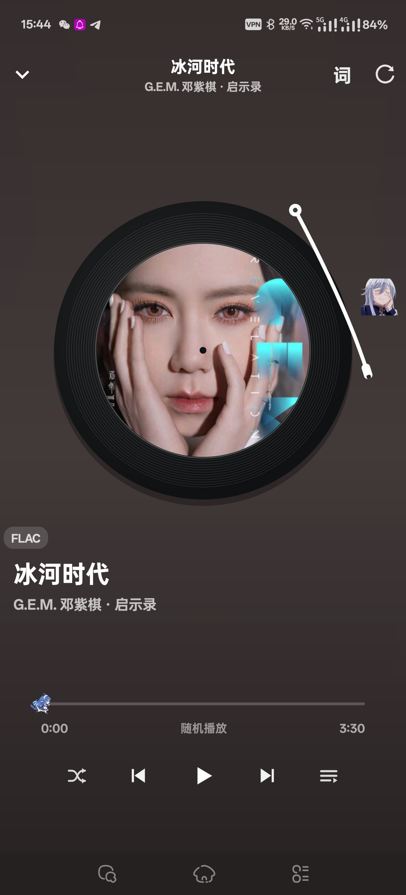

# DSH-musicdl

DSH-MD 是一款使用 **DSH** 基于 [MrsEWE44/musicDownload](https://github.com/MrsEWE44/musicDownload) 开发的 **Android 原生手机音乐播放器 APP**。

上游 musicDownload 是一个基于 Python 的桌面音乐搜索、下载工具；本项目把多平台音乐检索与下载能力带到手机端，并用原生 Android View 实现了完整的播放器、歌词与桌面歌词体验。

<p align="center">
  
</p>

## 功能

- 多平台音乐搜索与下载：QQ 音乐、网易云音乐、酷狗音乐、酷我音乐
- 支持无损及常见音频格式，下载时按歌手名自动创建并复用文件夹
- 本地曲库递归扫描，自动匹配歌词与封面
- 黑胶唱片播放器：封面取色背景、唱片旋转、唱针随播放状态摆动
- 点击封面切换歌词滚动模式
- 桌面歌词：颜色、字号、背景透明度可调，支持位置锁定
- 通知栏、锁屏控制与桌面播放器组件
- 播放列表支持按添加时间、歌手名、歌曲名 A-Z、歌手名 A-Z 排序，排序不打断当前播放
- 播放器布局自适应不同分辨率，适配高分辨率手机屏幕

## 技术栈

- Java 17
- Android SDK 37（compileSdk / targetSdk 37，minSdk 26）
- 纯原生 Android View，无 WebView、无第三方运行时依赖

## 构建

需要 JDK 17 与 Android SDK 37。

```bash
git clone https://github.com/qianwumao/DSH-musicdl.git
cd DSH-musicdl
# 在 local.properties 中配置 sdk.dir
./gradlew assembleDebug
```

Windows 使用 `gradlew.bat assembleDebug`，产物位于 `app/build/outputs/apk/debug/app-debug.apk`。

## 项目结构

```text
app/src/main/java/com/musicdl/android/
├── MainActivity.java        # 搜索、下载与本地曲库
├── PlayerActivity.java      # 播放器界面与响应式布局
├── source/                  # QQ / 网易云 / 酷狗 / 酷我解析
├── player/                  # 播放服务、歌词、桌面组件
├── util/                    # 下载、存储、歌词解析
└── view/                    # 黑胶唱片、进度条自定义视图
```

## 声明

本项目仅用于学习与技术交流。音乐版权归各音乐平台及版权方所有，请勿将本项目用于商业用途或大规模分发受版权保护的内容。

## 致谢

- [MrsEWE44/musicDownload](https://github.com/MrsEWE44/musicDownload)
- [CharlesPikachu/musicdl](https://github.com/CharlesPikachu/musicdl)
